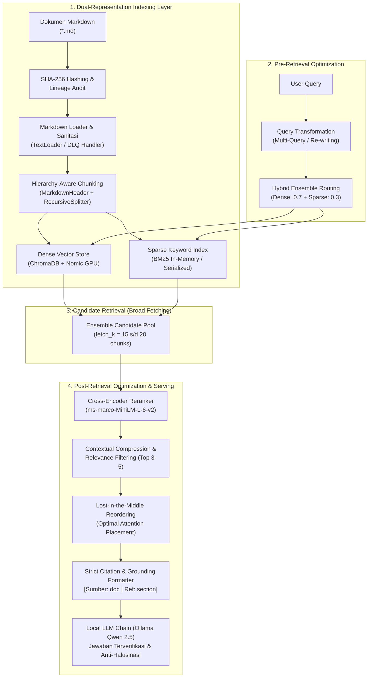
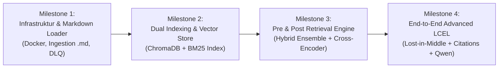

# Product Requirement Document (PRD): rag_langchain
**Sistem Advanced Retrieval-Augmented Generation (Advanced RAG) On-Premise Air-Gapped Berbasis LangChain, ChromaDB, & BM25**

---

## 1. Ringkasan Eksekutif (Executive Summary)

### 1.1 Latar Belakang
Banyak organisasi dan unit bisnis memerlukan sistem asisten kecerdasan buatan (*AI assistant*) untuk menelusuri dan menjawab pertanyaan terkait dokumen administratif, pedoman operasional standar (SOP), regulasi hukum, dan data internal sensitif. Kebutuhan utama organisasi tersebut adalah keamanan data maksimal (*zero data leakage*) dan akurasi referensi kutipan (*grounded citation*) yang dapat diverifikasi tanpa halusinasi.

### 1.2 Solusi Produk
**`rag_langchain`** adalah platform **Advanced Retrieval-Augmented Generation (Advanced RAG)** mandiri (*on-premise / air-gapped*) yang dioptimalkan untuk perangkat keras lokal dengan arsitektur memori terintegrasi (khususnya prosesor **Intel Core Ultra 125H - Meteor Lake**). 

Berbeda dengan Naive RAG standar yang rentan terhadap kegagalan temu kembali (*retrieval mismatch*) dan distorsi konteks, sistem ini mengimplementasikan paradigma **Advanced RAG** dengan dua pilar optimasi utama:
1. **Pre-Retrieval Optimization**: *Multi-Query Expansion*, *Hierarchical / Markdown Header-aware Chunking*, serta *Hybrid Ensemble Search* yang menggabungkan *Dense Vector Search* (ChromaDB + Nomic Embed Text GPU) dan *Sparse Keyword Search* (BM25).
2. **Post-Retrieval Optimization**: *Two-Stage Cross-Encoder Reranking*, *Contextual Compression & Relevance Filtering*, serta *Lost-in-the-Middle Context Reordering* sebelum diserahkan ke *Local LLM* (Qwen 2.5-7B INT4 via Ollama).

---

## 2. Tujuan & Sasaran Bisnis (Goals & Objectives)

| Tujuan Utama | Sasaran Terukur (Target KPI) |
| :--- | :--- |
| **Keamanan & Kepatuhan Data** | 100% *Air-Gapped* / *Offline*: Nol paket data yang keluar ke internet publik selama proses parsing, embedding, reranking, maupun inferensi. |
| **Akurasi & Sitasi Presisi (Advanced RAG)** | Setiap jawaban wajib menyertakan rujukan sitasi format kanonikal: `[Sumber: <nama_dokumen> \| Bagian/Hal: <referensi>]` dengan skor *groundedness* > 92%. |
| **Kualitas Temu Kembali (Retrieval Precision)** | *Ensemble Hybrid Search* + *Cross-Encoder Reranking* meningkatkan *Mean Reciprocal Rank (MRR)* dan *Recall@5* sebesar minimal 35% dibandingkan Naive Vector Search murni. |
| **Efisiensi Komputasi Lokal** | Berjalan stabil pada Intel Core Ultra 125H tanpa *Out-of-Memory (OOM)* dengan akselerasi GPU (Intel Arc iGPU / XPU) untuk embedding berkecepatan tinggi serta alokasi VRAM terkontrol (< 4.5 GB). |
| **Idempotensi & Lineage Pipeline** | 0% duplikasi vektor saat re-index; berkas `.md` yang tidak berubah dilewati (*cache hit*); pelacakan lineage berbasis SHA-256. |
| **Toleransi Kegagalan (Fault Tolerance)** | Pipeline parsing batch tidak boleh terhenti (*crash*) jika satu file korup; berkas bermasalah dialihkan ke *Dead-Letter Queue (DLQ)*. |

---

## 3. Profil Pengguna (User Personas)

1. **Knowledge Worker / Staf Administrasi**:
   - Membutuhkan jawaban cepat atas prosedur dinas dan regulasi internal.
   - Membutuhkan bukti nomor halaman dan nama dokumen asli untuk validasi manual.
2. **AI & Data Engineer / Developer**:
   - Mengelola pembaruan dokumen melalui CLI, memantau integritas data, dan mengonfigurasi parameter embedding/chunking.
3. **Sistem Admin & Security Officer**:
   - Memastikan kepatuhan isolasi jaringan (*air-gapped*), tidak adanya telemetri cloud, dan retensi log error terpusat.

---

## 4. Batasan & Lingkungan Operasional (System Constraints)

- **Target Hardware**: Laptop / Mini PC Intel Core Ultra 125H (14 Cores / 18 Threads, Intel Arc 7 Xe-Cores iGPU, Shared Unified Memory).
- **Strategi Akselerasi GPU & Manajemen Alokasi Memori**:
  - **Akselerasi GPU untuk Embedding**: Pembangkitan embedding lokal (`nomic-ai/nomic-embed-text-v1.5`) memanfaatkan akselerasi GPU (Intel Arc iGPU via backend PyTorch `xpu` / Level Zero atau CUDA) untuk meningkatkan *throughput* pemrosesan chunk hingga 3x-5x lebih cepat dibandingkan CPU murni.
  - **Shared VRAM Budget (Maks. 4.5 GB)**: Alokasi total VRAM bersama dikelola secara ketat dengan *batch size* terukur (misal `batch_size=16` - `32`) sehingga memori GPU mencukupi untuk proses embedding batch maupun inferensi Local LLM (Qwen 2.5-7B INT4 via Ollama/IPEX-LLM).
  - **Fase Eksekusi Terkoordinasi**: Pada tahap ingestion masal (`build_index.py`), GPU dapat diprioritaskan penuh untuk embedding throughput. Saat fase serving query RAG interaktif, embedding kueri dan LLM generation berbagi alokasi VRAM secara bergantian tanpa memicu *Out-Of-Memory (OOM)*.
  - **ChromaDB Docker Container**: Dibatasi maksimal 1024 MB RAM via Docker Compose resource limits.
- **Sistem Operasi**: Linux / Ubuntu 22.04+ LTS.
- **Isolasi Jaringan**: `HF_HUB_OFFLINE=1`, `TRANSFORMERS_OFFLINE=1`, telemetri Chroma dinonaktifkan (`ANONYMIZED_TELEMETRY=FALSE`).

---

## 5. Arsitektur Data Pipeline (Advanced RAG Pattern)

Pipeline mengadopsi arsitektur **Advanced RAG** yang memisahkan proses menjadi 4 lapisan berurutan: **Indexing (Dual-Representation)**, **Pre-Retrieval Optimization**, **Hybrid Candidate Retrieval**, dan **Post-Retrieval Optimization & Grounding**.



---

## 6. Kebutuhan Fungsional (Functional Requirements)

### 6.1 Modul Ingestion Dokumen Markdown (Direct Ingestion)
- **FR-1.1 Format Masukan Langsung (.md)**: Sistem menerima dokumen berformat Markdown (`*.md`) secara langsung di direktori data (`data/raw/`) tanpa memerlukan perantara parser biner berat seperti PyMuPDF.
- **FR-1.2 SHA-256 Fingerprinting**: Menghitung sidik jari kriptografi (SHA-256) untuk setiap berkas `.md` sebagai acuan *idempotency* dan pelacakan audit versi dokumen.
- **FR-1.3 Lineage Metadata Capture**: Merekam metadata dasar: `document_name` (nama berkas `.md`), ukuran berkas, jumlah baris, dan tanggal ingest.

### 6.2 Modul Parsing, Sanitasi, & Kualitas Data (Markdown Validation)
- **FR-2.1 Parsing Dokumen Markdown Native**: Membaca file `.md` secara langsung menggunakan modul I/O teks bawaan / LangChain `TextLoader`.
- **FR-2.2 Preservasi Struktur Hirarki & Metadata Bagian**:
  - Mengekstrak struktur hirarki Markdown (judul bab `#`, sub-bab `##`, `###`).
  - Mendeteksi penanda halaman manual jika tersedia dalam teks Markdown (misal: tag `[Hal: X]` atau komentar `<!-- page: X -->`).
  - Menetapkan atribut sitasi rujukan (`document_name`, `section`, dan `page_number` jika tertera).
- **FR-2.3 Quality Gates**:
  - Memvalidasi integritas encoding (sanitasi UTF-8 tanpa karakter null/biner korup).
  - Menolak dokumen `.md` kosong atau berukuran kurang dari 50 karakter terbaca.
- **FR-2.4 Dead-Letter Queue (DLQ)**: Berkas `.md` yang gagal dibaca (encoding korup, unreadable, teks kosong) otomatis dipindahkan ke `data/dlq/` disertai pencatatan `error.log` terstruktur tanpa mematikan proses batch.

### 6.3 Modul Chunking & Dual-Representation Indexing (Gold Layer)
- **FR-3.1 Hierarchy-Aware Chunking**: Mengombinasikan `MarkdownHeaderTextSplitter` dengan `RecursiveCharacterTextSplitter` dari LangChain:
  - Memotong teks berdasarkan batasan bab semantik (`#`, `##`, `###`) terlebih dahulu, kemudian membagi bagian panjang dengan `chunk_size=256` token dan `chunk_overlap=26` token.
  - Memastikan judul bab dan konteks hierarki melekat pada setiap chunk.
- **FR-3.2 Injeksi Metadata Lengkap**: Setiap unit `Document` hasil chunking wajib menyertakan skema metadata:
  ```json
  {
    "document_name": "pedoman_organisasi.md",
    "section": "Struktur Organisasi",
    "page_number": 1,
    "chunk_id": "a1b2c3d4..._c001",
    "chunk_index": 1,
    "doc_hash": "a1b2c3d4...",
    "source": "data/raw/pedoman_organisasi.md",
    "indexed_at": "2026-11-10T14:00:00Z"
  }
  ```
- **FR-3.3 Idempotensi Deterministik**: Menghasilkan `chunk_id` dengan format deterministik `<doc_sha256>_c<chunk_index>`. Jika dokumen dengan hash yang sama sudah ada di indeks, proses pembuatan vektor dilewati.
- **FR-3.4 Dual Indexing (Dense + Sparse)**:
  - **Dense Index**: Membangkitkan embedding dengan model `nomic-ai/nomic-embed-text-v1.5` yang diakselerasi GPU dan disimpan di ChromaDB.
  - **Sparse Index**: Membangun index kata kunci berbasis algoritma **BM25** (`BM25Retriever`) dari korpus chunk dokumen yang sama untuk pencarian term exact/akronim.

### 6.4 Modul Pre-Retrieval Optimization
- **FR-4.1 Query Rewriting & Multi-Query Expansion**:
  - Sistem menyediakan mekanisme *MultiQueryRetriever* yang memanfaatkan LLM lokal untuk menghasilkan 2–3 variasi perspektif kueri dari satu kueri masukan pengguna.
  - Membantu menangani kueri pengguna yang ambigu, bersinonim khusus, atau memiliki formulasi bahasa informal.
- **FR-4.2 Hybrid Ensemble Search**:
  - Menggabungkan hasil pencarian semantik (ChromaDB Vector Store) dan pencarian leksikal (BM25 Retriever) menggunakan `EnsembleRetriever` LangChain dengan bobot default `[0.7 dense, 0.3 sparse]`.
  - Mengambil kandidat awal dalam jumlah lebih banyak (`fetch_k=15` sampai `20` chunk) sebelum masuk ke tahap reranking.
- **FR-4.3 Metadata Pre-Filtering**: Mendukung penyaringan awal (*hard filter*) berdasarkan atribut `document_name` atau `section` sebelum komputasi similarity dilakukan.

### 6.5 Modul Post-Retrieval Optimization
- **FR-5.1 Two-Stage Cross-Encoder Reranking**:
  - Menggunakan model reranker lokal ringan (`cross-encoder/ms-marco-MiniLM-L-6-v2` via `sentence-transformers`).
  - Menghitung skor interaksi silang penuh (*full cross-attention*) antara kueri pengguna dan 15–20 kandidat chunk awal.
  - Memilih **top-k=3 sampai 5 chunk teratas** dengan akurasi semantik tertinggi.
- **FR-5.2 Contextual Compression & Relevance Filtering**:
  - Memotong bagian kalimat atau paragraf yang tidak relevan di dalam chunk (*selective extraction*) untuk menghemat kapasitas konteks LLM.
  - Menerapkan *score cut-off threshold* untuk membuang chunk kandidat dengan skor reranking di bawah batas relevansi minimum.
- **FR-5.3 Lost-in-the-Middle Reordering**:
  - Mengatur ulang urutan chunk relevan agar potongan teks dengan skor tertinggi ditempatkan di posisi **paling awal** dan **paling akhir** dari prompt konteks (mengatasi kecenderungan LLM mengabaikan informasi di bagian tengah konteks).
- **FR-5.4 Formatter Sitasi Presisi & Grounding**:
  - Menginjeksi penanda sitasi kanonikal pada setiap chunk yang disajikan ke LLM:
    ```text
    [Sumber: {document_name} | Bagian: {section} | Hal: {page_number}]
    {teks_konten_terkompresi}
    ```

### 6.6 Modul Orkestrasi Generasi (LangChain LCEL & Local LLM)
- **FR-6.1 Integrasi Local LLM**: Menghubungkan chain dengan Ollama (model Qwen 2.5-7B INT4) yang berjalan di lokal dengan akselerasi IPEX-LLM pada Intel Arc iGPU.
- **FR-6.2 Parameter Inferensi**: Temperatur rendah (`0.1`), batas token jawaban (`256`), batas konteks window (`2048`).
- **FR-6.3 Anti-Halusinasi Prompt**: Menginstruksikan LLM untuk hanya menjawab berdasarkan konteks yang disediakan dan selalu menyertakan sitasi sumber/halaman. Jika konteks tidak memadai, LLM wajib menyatakan ketidaktahuannya secara eksplisit.

### 6.7 Modul Evaluasi Advanced RAG (RAG Triad & Metrics)
- **FR-7.1 Metrik Kualitas Temu Kembali (Context Relevance & Recall)**: Mengevaluasi apakah potongan teks yang diambil benar-benar relevan dengan kueri.
- **FR-7.2 Metrik Kepatuhan Jawaban (Groundedness / Faithfulness)**: Memverifikasi bahwa setiap klaim jawaban model dapat ditelusuri langsung ke teks konteks rujukan tanpa halusinasi.
- **FR-7.3 Metrik Relevansi Jawaban (Answer Relevance)**: Memastikan jawaban langsung menjawab inti kueri pengguna.

### 6.8 Modul Antarmuka & Otomasi Operasional
- **FR-8.1 CLI Index Builder (`scripts/build_index.py`)**:
  - Mendukung mode `--incremental` (hanya memproses berkas baru/berubah).
  - Mendukung mode `--reset` (mengosongkan koleksi ChromaDB dan rebuild dari awal).
  - Membangun index ganda (vektor ChromaDB + indeks BM25).
  - Mendukung penentuan direktori masukan kustom `--data-dir`.
- **FR-8.2 CLI Tester Retrieval (`scripts/test_retrieval.py`)**:
  - Menguji kueri teks langsung dari terminal dengan opsi lanjutan:
    - `--hybrid`: Mengaktifkan penggabungan dense + sparse BM25.
    - `--rerank`: Mengaktifkan Cross-Encoder reranking.
    - `--k <int>`: Jumlah dokumen akhir yang dikembalikan.
    - `--doc <nama_berkas>`: Filter dokumen tertentu.
- **FR-8.3 Antarmuka Chat Interaktif Natural (OpenWebUI via Docker)**:
  - Menyediakan portal web conversational UI berbasis Docker (OpenWebUI) pada port 3000 (`http://localhost:3000`).
  - Terkoneksi ke Ollama lokal via `host.docker.internal:11434`.
  - Mendukung respons *streaming token*, penyesuaian parameter percakapan, dan pengujian kualitas respons RAG dengan pengalaman chat yang natural bagi pengguna awam dan evaluator.

---

## 7. Kebutuhan Non-Fungsional (Non-Functional Requirements)

| Kategori | Spesifikasi Kebutuhan |
| :--- | :--- |
| **Keamanan & Privasi** | *Zero network egress*. Tidak ada data teks atau metrik yang dikirim ke penyedia eksternal. Telemetri dinonaktifkan. Seluruh data tersimpan secara lokal. |
| **Kinerja & Latensi** | - Akselerasi GPU untuk embedding menghasilkan kecepatan vektorisasi > 150-250 chunks/detik pada batching teroptimasi.<br/>- Latensi retrieval hybrid (Chroma + BM25) < 250 ms.<br/>- Latensi Cross-Encoder Reranking < 120 ms untuk 20 kandidat di Intel Core Ultra 125H.<br/>- Latensi time-to-first-token (TTFT) LLM lokal < 1.5 detik. |
| **Kualitas Temu Kembali & Groundedness** | - Skor *Faithfulness* / *Groundedness* > 92% (tidak ada halusinasi fakta di luar konteks rujukan).<br/>- Peningkatan relevansi konteks (*Context Precision*) minimal 35% dibandingkan Naive Vector Search. |
| **Manajemen Memori** | Konsumsi memori terintegrasi stabil: utilisasi GPU VRAM terkelola di bawah 4.5 GB dengan batching guardrails, ChromaDB container dibatasi 1 GB RAM, mencegah sistem *freeze* / swap thrashing. |
| **Keandalan & Idempotensi**| Eksekusi build berulang tidak menghasilkan data duplikat atau corrupt state. Fail-safe DLQ untuk isolasi berkas yang gagal diproses. |
| **Auditabilitas** | Riwayat chunk dapat ditelusuri langsung ke file sumber, checksum file asal, dan nomor halaman. |

---

## 8. Spesifikasi Arsitektur Modul & Struktur Proyek

```text
rag_langchain/
├── config/
│   ├── __init__.py
│   ├── config.yaml          # Parameter konfigurasi master (Chroma, BM25, reranker, batas memori)
│   └── settings.py          # Loader Pydantic/dataclass konfigurasi otomatis (.env)
├── data/
│   ├── raw/                 # Input Dokumen: Berkas Markdown (*.md)
│   ├── processed/           # Arsip / Cache metadata terstruktur (.json / .md)
│   └── dlq/                 # Dead-Letter Queue: Berkas .md korup/gagal beserta log error
├── logs/                    # Catatan riwayat eksekusi pipeline & audit program (*.log)
├── src/
│   ├── ingestion/           # Pipeline Ingestion: Markdown loader, validator teks, & DLQ handler
│   ├── processing/          # Hierarchy-aware chunking (MarkdownHeader + RecursiveSplitter)
│   ├── embeddings/          # Wrapper model embedding lokal Nomic (Akselerasi GPU / XPU)
│   ├── vector_store/        # Klien ChromaDB Docker (upsert, query, filtering, deduplikasi)
│   ├── retrievers/          # Modul Advanced RAG: Hybrid Ensemble (Chroma + BM25) & Multi-Query
│   ├── rerankers/           # Modul Post-Retrieval: Cross-Encoder reranker & Contextual Compression
│   └── chains/              # LCEL Chains: Grounded citation formatter & Ollama integration
├── scripts/
│   ├── build_index.py       # Orchestrator CLI pipeline indexing (ChromaDB + BM25)
│   └── test_retrieval.py    # CLI tool verifikasi pencarian semantik, hybrid, reranker, & sitasi
├── docker-compose.yml       # Definisi container ChromaDB (port 8001) & OpenWebUI (port 3000)
├── requirements.txt         # Daftar pustaka Python terisolasi (Chroma, BM25, SentenceTransformers)
├── .env.example             # Template konfigurasi variabel lingkungan
├── .env                     # Konfigurasi aktif lokal (Air-gapped flags & IPEX parameters)
├── SETUP.md                 # Panduan teknis instalasi dan eksekusi
└── PRD.md                   # Dokumen spesifikasi kebutuhan produk (PRD ini)
```

---

## 9. Rencana Implementasi & Milestone



1. **Milestone 1 (Infrastruktur & Markdown Ingestion)**:
   - Setup ChromaDB via Docker Compose dengan resource limit 1 GB.
   - Implementasi Markdown loader native dengan validasi UTF-8, ekstraksi struktur/penanda halaman, dan isolasi DLQ.
2. **Milestone 2 (Gold Chunking & Dual Indexing)**:
   - Implementasi LangChain `MarkdownHeaderTextSplitter` + `RecursiveCharacterTextSplitter` dengan skema metadata lengkap.
   - Pembangkitan indeks Dense di ChromaDB (akselerasi GPU) dan indeks Sparse BM25.
   - Validasi script `build_index.py` dengan mode incremental dan serialisasi cache BM25.
3. **Milestone 3 (Pre-Retrieval & Post-Retrieval Optimization)**:
   - Implementasi `EnsembleRetriever` (gabungan Chroma 70% + BM25 30%) dan Multi-Query Expansion.
   - Integrasi model Cross-Encoder (`ms-marco-MiniLM-L-6-v2`) untuk pemeringkatan ulang 20 kandidat ke top 3–5.
   - Verifikasi performa via `test_retrieval.py --hybrid --rerank`.
4. **Milestone 4 (Orkestrasi LCEL, Grounding, & Local LLM)**:
   - Penerapan *Lost-in-the-Middle Reordering* dan formatter sitasi kanonikal `[Sumber: <doc> | Bagian: <sec>]`.
   - Integrasi rantai LCEL dengan Ollama IPEX-LLM (Qwen 2.5-7B INT4).
   - Evaluasi kualitas groundedness dan anti-halusinasi.

---

## 10. Kriteria Penerimaan (Acceptance Criteria)

- [ ] **AC-1**: Menjalankan `docker compose up -d` menghasilkan container ChromaDB yang sehat (*healthy*) pada port 8001 dengan limit memori 1024 MB.
- [ ] **AC-2**: Menempatkan berkas `.md` baru di `data/raw/` dan menjalankan `python scripts/build_index.py` berhasil membangun dense index di ChromaDB dan sparse index BM25 secara terkoordinasi.
- [ ] **AC-3**: Jika berkas `.md` korup/rusak dimasukkan ke `data/raw/`, berkas dipindahkan ke `data/dlq/`, log error tercatat di `data/dlq/error.log`, dan berkas valid lainnya tetap terindeks tanpa error tak tertangani.
- [ ] **AC-4**: Menjalankan ulang `build_index.py` tanpa mengubah berkas menghasilkan *0 embedding baru* (*idempotent cache hit*).
- [ ] **AC-5**: Menjalankan `python scripts/test_retrieval.py "<kueri>" --hybrid --rerank` mengembalikan potongan teks relevan dengan skor akurasi reranking lebih tinggi dibandingkan pencarian vektor tunggal biasa.
- [ ] **AC-6**: Jawaban LLM akhir selalu menyertakan rujukan sitasi `[Sumber: {document_name} | Bagian: {section}]` dan tidak mengalami halusinasi pada fakta yang tidak tersedia dalam konteks.
- [ ] **AC-7**: Sistem berjalan sepenuhnya secara offline (*air-gapped*) tanpa dependensi ke internet saat variabel `HF_HUB_OFFLINE=1` dan `TRANSFORMERS_OFFLINE=1` aktif.
- [ ] **AC-8**: Layanan antarmuka percakapan OpenWebUI dapat diakses pada `http://localhost:3000` dan terhubung langsung ke Ollama lokal untuk pengujian model dan validasi hasil RAG secara interaktif.
