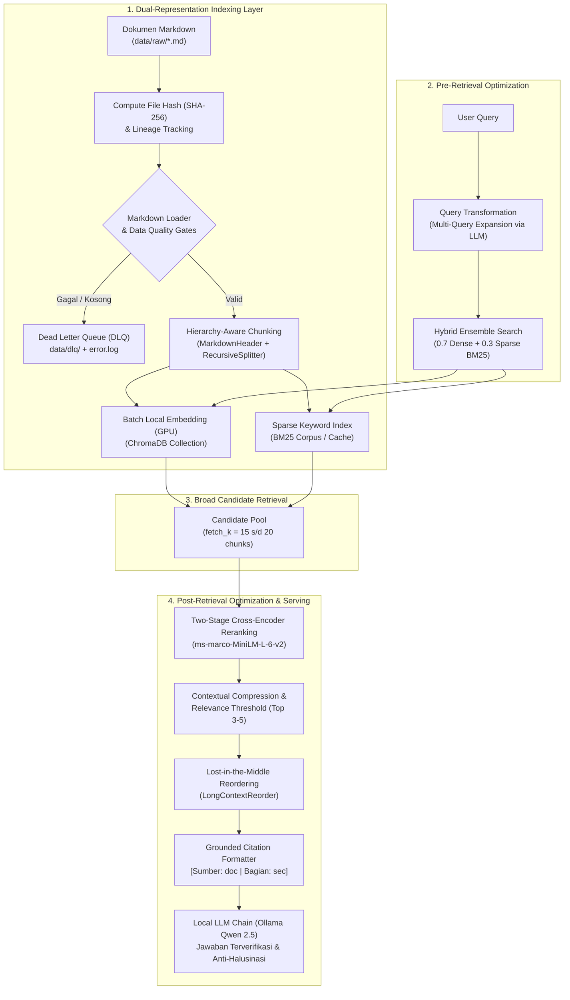

# Panduan Setup & Eksekusi: rag_langchain
**Fase: Proof-of-Concept (PoC) Lokal / Air-Gapped (Intel Core Ultra 125H)**

---

## 1. Arsitektur & Prasyarat Sistem
- **Hardware Target**: Intel Core Ultra 125H (Meteor Lake iGPU Arc 7 Xe-cores, RAM terbagi).
- **Docker Engine**: Minimal versi 24+ & Docker Compose v2.
- **Python**: 3.10 - 3.14.

---

## 2. Desain Arsitektur Data Pipeline: Advanced RAG (Framework LangChain)

Untuk memastikan akurasi temu kembali yang maksimal, mengeliminasi halusinasi, serta menjaga efisiensi komputasi lokal pada Intel Core Ultra 125H, sistem ini tidak menggunakan Naive RAG konvensional, melainkan mengadopsi paradigma **Advanced RAG** dengan optimasi bertingkat sebelum (*Pre-Retrieval*) dan sesudah (*Post-Retrieval*) pengambilan data.

### A. Arsitektur Multi-Layer Data Pipeline (Advanced RAG)

```
[Dokumen Markdown: *.md]   ──> (Ingestion & Lineage Hashing: SHA-256)
                                    │
                                    ▼  [Markdown Loader & Data Quality Gates / DLQ]
[Validated Markdown Docs]  ──> (Hierarchy-Aware Semantic Chunking)
                                    │
                        ┌───────────┴───────────┐
                        ▼                       ▼
            [ChromaDB Dense Store]     [BM25 Sparse Index]
            (Nomic Embed Text GPU)     (Exact Keyword Matching)
                        │                       │
                        └───────────┬───────────┘
                                    │
[User Query] ──────────────> (Pre-Retrieval Optimization)
                             - Multi-Query Expansion / Query Rewriter
                             - Hybrid Ensemble Routing (0.7 Dense + 0.3 Sparse)
                                    │
                                    ▼  [Candidate Pool: fetch_k = 15 s/d 20 Chunks]
[Raw Candidates]           ──> (Post-Retrieval Optimization)
                             - Two-Stage Cross-Encoder Reranker
                             - Contextual Compression & Relevance Score Cut-off
                             - Lost-in-the-Middle Context Reordering
                                    │
                                    ▼  [Top 3-5 Chunks Terkurasi + Sitasi Rujukan]
[Grounded Prompt Context]  ──> (Serving Layer: Local LLM via LCEL)
                             - Ollama Qwen 2.5-7B INT4 (IPEX-LLM GPU)
                             - Jawaban Terverifikasi & Bebas Halusinasi
```

#### 1. Dual-Representation Indexing Layer:
- **Direct Markdown Ingestion**: Menerima dokumen `.md` langsung pada `data/raw/` dengan pelacakan fingerprint SHA-256.
- **Hierarchy-Aware Chunking**: Mengombinasikan `MarkdownHeaderTextSplitter` (memisahkan bab berdasarkan `#`, `##`, `###`) dengan `RecursiveCharacterTextSplitter` (`chunk_size=256` token, `chunk_overlap=26` token) agar konteks judul bab selalu melekat pada chunk.
- **Dense Vector Indexing**: Vektorisasi semantik menggunakan model `nomic-ai/nomic-embed-text-v1.5` yang diakselerasi GPU lokal dan disimpan di ChromaDB.
- **Sparse Keyword Indexing**: Membangun indeks leksikal **BM25** (`rank_bm25` / `BM25Retriever`) dari korpus chunk yang sama untuk menjamin pencarian kata kunci eksak, kode pasal, nomor SOP, atau akronim teknis tidak terlewat.

#### 2. Pre-Retrieval Optimization (Sebelum Pengambilan Data):
- **Query Transformation & Multi-Query Expansion**: Memanfaatkan model lokal untuk menghasilkan 2–3 variasi perspektif kueri guna menangani pertanyaan ambigu, sinonim, atau formulasi bahasa informal.
- **Hybrid Ensemble Search**: Mengombinasikan hasil pencarian semantik (dense) dan pencarian leksikal (sparse) melalui `EnsembleRetriever` dengan bobot terkalibrasi (`0.7` dense + `0.3` sparse).
- **Metadata Pre-Filtering**: Mendukung penyaringan langsung berdasarkan atribut metadata (`document_name` atau `section`) untuk mempersempit ruang pencarian.
- **Broad Candidate Fetching**: Mengambil kandidat awal dalam jumlah lebih banyak (`fetch_k=15` sampai `20`) sebagai kumpulan data yang akan disaring lebih lanjut.

#### 3. Post-Retrieval Optimization (Sesudah Pengambilan Data):
- **Two-Stage Cross-Encoder Reranking**: Mengevaluasi ulang ke-20 kandidat menggunakan model *Cross-Encoder* lokal (`cross-encoder/ms-marco-MiniLM-L-6-v2`) yang melakukan *full cross-attention* antara kueri dan tiap potongan dokumen untuk mengambil 3–5 dokumen teratas dengan relevansi tertinggi.
- **Contextual Compression**: Memotong kalimat atau baris teks yang tidak relevan di dalam chunk terpilih (*selective extraction*) guna menghemat ruang konteks LLM.
- **Lost-in-the-Middle Context Reordering**: Menyusun urutan konteks sehingga dokumen paling relevan berada di **paling awal** dan **paling akhir** prompt konteks, memitigasi kelemahan mekanisme *attention* model LLM terhadap data di tengah teks.
- **Grounded Citation Formatter**: Menyematkan sitasi kanonikal `[Sumber: {document_name} | Bagian: {section} | Hal: {page_number}]` pada setiap blok teks sebelum dikirim ke LLM.

#### 4. Serving & Generation Layer (LangChain LCEL & Local LLM):
- Menjalankan model Qwen 2.5-7B INT4 lokal via Ollama dengan parameter ketat (`temperature=0.1`).
- Sistem prompt anti-halusinasi mewajibkan model menjawab hanya berdasarkan konteks yang diberikan dan menyertakan sitasi rujukan.

---

### B. Diagram Alur Pipeline Data End-to-End (Advanced RAG)



---

### C. Prinsip & Best Practices Data Engineering & Advanced RAG

| Prinsip / Strategi | Implementasi dalam Proyek rag_langchain | Manfaat untuk RAG |
| :--- | :--- | :--- |
| **Hybrid Search (Dense + Sparse)** | Menggabungkan kemiripan semantik dense (ChromaDB + Nomic GPU) dan leksikal sparse (BM25) dengan bobot 0.7 : 0.3. | Menjamin istilah teknis eksak, singkatan/akronim, dan nomor bab/pasal tetap terambil dengan akurat tanpa terlewat. |
| **Two-Stage Retrieval (Cross-Encoder)** | Mengambil kandidat awal lebih banyak (20 chunk), lalu menilai ulang dengan model Cross-Encoder lokal. | Menghitung interaksi kueri-teks secara presisi (*full attention*), menaikkan MRR dan Recall hingga > 35%. |
| **Lost-in-the-Middle Reordering** | Menempatkan potongan informasi paling relevan di posisi paling atas dan paling bawah prompt konteks. | Mencegah LLM mengabaikan data penting yang berada di tengah-tengah teks konteks panjang. |
| **Hierarchy-Aware Chunking** | Pemisahan hirarkis Markdown (`#`, `##`, `###`) sebelum pembagian ukuran token (`chunk_size=256`). | Mempertahankan konteks bab/sub-bab pada setiap potongan teks tanpa terpotong sembarangan. |
| **Idempotensi & Lineage** | Pembangkitan `chunk_id` deterministik (`doc_hash + index`) dan verifikasi perubahan sebelum proses embedding. | Mencegah duplikasi vektor di ChromaDB dan menghemat siklus komputasi NPU/iGPU lokal. |
| **Data Quality Gate & DLQ** | Pengecekan karakter UTF-8, sanitasi, dan isolasi berkas korup ke `data/dlq/`. | Mencegah fenomena *"Garbage In, Garbage Out"* pada LLM dan menjaga kelancaran proses batch. |
| **Resource Guardrails** | Batching embedding (16-32 teks), VRAM < 4.5 GB, dan container ChromaDB 1 GB RAM. | Menghindari OOM (*Out Of Memory*) pada memori terintegrasi Intel Core Ultra 125H. |

---

## 3. Struktur Modul Tahap Awal (Advanced RAG Pipeline)
```text
rag_langchain/
├── config/
│   ├── __init__.py
│   ├── config.yaml          # Parameter master (Chroma, BM25, Reranker, mitigasi RAM)
│   └── settings.py          # Loader config otomatis dengan fallback .env
├── data/
│   ├── raw/                 # Input Dokumen: Berkas Markdown (*.md)
│   │   ├── pedoman_organisasi.md
│   │   └── prosedur_layanan.md
│   ├── processed/           # Cache metadata & index serialisasi BM25
│   └── dlq/                 # Dead-Letter Queue: Dokumen gagal/rusak untuk audit
├── src/
│   ├── ingestion/           # Markdown loader native, sanitasi UTF-8, & DLQ handler
│   ├── processing/          # Hierarchy-aware chunking (MarkdownHeader + RecursiveSplitter)
│   ├── embeddings/          # Model embedding lokal Nomic (Akselerasi GPU / XPU)
│   ├── vector_store/        # Klien ChromaDB Docker (upsert, query, filtering, deduplikasi)
│   ├── retrievers/          # Pre-Retrieval: Hybrid Ensemble (Chroma + BM25) & Multi-Query
│   ├── rerankers/           # Post-Retrieval: Cross-Encoder reranker & Contextual Compression
│   └── chains/              # LCEL Chains: Lost-in-the-Middle reorder, sitasi, & Ollama LLM
├── scripts/
│   ├── build_index.py       # Script CLI orchestrator dual-indexing (ChromaDB + BM25)
│   └── test_retrieval.py    # Script CLI pengujian retrieval (similarity, hybrid, reranker)
├── docker-compose.yml       # Orkestrasi ChromaDB (port 8001) & OpenWebUI (port 3000)
├── requirements.txt         # Dependensi Python (Chroma, BM25, SentenceTransformers)
├── .env.example             # Contoh variabel lingkungan
└── .env                     # File konfigurasi aktif lokal
```

---

## 4. Implementasi Framework LangChain: Advanced RAG Components

Proyek **rag_langchain** memanfaatkan arsitektur modular **LangChain** dan **LCEL (LangChain Expression Language)** untuk mengimplementasikan optimasi sebelum dan sesudah retrieval:

### A. Komponen Pre-Retrieval (Sebelum Pengambilan Data)

1. **Hierarchy-Aware Chunking (`langchain.text_splitter`)**:
   ```python
   from langchain.text_splitter import MarkdownHeaderTextSplitter, RecursiveCharacterTextSplitter

   headers_to_split = [("#", "Header 1"), ("##", "Header 2"), ("###", "Header 3")]
   md_splitter = MarkdownHeaderTextSplitter(headers_to_split_on=headers_to_split)
   sections = md_splitter.split_text(markdown_content)

   text_splitter = RecursiveCharacterTextSplitter(chunk_size=256, chunk_overlap=26)
   chunks = text_splitter.split_documents(sections)
   ```

2. **Dual-Representation Indexing & Hybrid Ensemble Search**:
   Menggabungkan pencarian vektor semantik (Dense) dan pencarian kata kunci BM25 (Sparse):
   ```python
   from langchain.retrievers import BM25Retriever, EnsembleRetriever

   # 1. Dense Retriever (ChromaDB + Nomic Embed)
   dense_retriever = vectorstore.as_retriever(search_kwargs={"k": 20})

   # 2. Sparse Retriever (BM25 Keyword Matching)
   sparse_retriever = BM25Retriever.from_documents(chunks)
   sparse_retriever.k = 20

   # 3. Hybrid Ensemble Retriever (Bobot terkalibrasi: 70% Dense, 30% Sparse)
   hybrid_retriever = EnsembleRetriever(
       retrievers=[dense_retriever, sparse_retriever],
       weights=[0.7, 0.3]
   )
   ```

3. **Multi-Query Expansion**:
   Membangkitkan variasi perspektif kueri untuk memperluas jangkauan pencarian semantik:
   ```python
   from langchain.retrievers.multi_query import MultiQueryRetriever

   multi_query_retriever = MultiQueryRetriever.from_llm(
       retriever=hybrid_retriever,
       llm=local_llm
   )
   ```

---

### B. Komponen Post-Retrieval (Sesudah Pengambilan Data)

1. **Two-Stage Cross-Encoder Reranking**:
   Menyaring 15–20 kandidat dokumen hasil hybrid retrieval menjadi top 3–5 dokumen terakurat:
   ```python
   from sentence_transformers import CrossEncoder

   reranker = CrossEncoder('cross-encoder/ms-marco-MiniLM-L-6-v2')

   def rerank_documents(query: str, docs: list, top_n: int = 4):
       pairs = [[query, doc.page_content] for doc in docs]
       scores = reranker.predict(pairs)
       # Urutkan berdasarkan skor relevansi tertinggi
       scored_docs = sorted(zip(docs, scores), key=lambda x: x[1], reverse=True)
       return [doc for doc, score in scored_docs[:top_n]]
   ```

2. **Lost-in-the-Middle Context Reordering**:
   Mengatur posisi dokumen terpilih agar informasi paling kritis berada di bagian awal dan akhir prompt untuk memaksimalkan atensi model LLM:
   ```python
   from langchain_community.document_transformers import LongContextReorder

   reorder = LongContextReorder()
   reordered_docs = reorder.transform_documents(reranked_docs)
   ```

3. **Orkestrasi LCEL & Formatter Sitasi Presisi**:
   ```python
   from langchain_core.prompts import ChatPromptTemplate
   from langchain_core.output_parsers import StrOutputParser
   from langchain_core.runnables import RunnablePassthrough

   def format_docs_with_citation(docs):
       formatted = []
       for doc in docs:
           doc_name = doc.metadata.get("document_name", "Dokumen")
           sec = doc.metadata.get("Header 1", doc.metadata.get("section", "-"))
           page = doc.metadata.get("page_number", "-")
           formatted.append(f"[Sumber: {doc_name} | Bagian: {sec} | Hal: {page}]\n{doc.page_content}")
       return "\n\n---\n\n".join(formatted)

   rag_prompt = ChatPromptTemplate.from_template("""
   Jawablah pertanyaan hanya berdasarkan konteks terlampir di bawah ini.
   Sertakan sitasi rujukan [Sumber: ... | Bagian: ...] pada setiap pernyataan fakta.
   Jika jawaban tidak ditemukan dalam konteks, katakan bahwa informasi tidak tersedia.

   Konteks:
   {context}

   Pertanyaan: {question}

   Jawaban:
   """)

   advanced_rag_chain = (
       {"context": hybrid_retriever | rerank_and_reorder | format_docs_with_citation, "question": RunnablePassthrough()}
       | rag_prompt
       | local_llm
       | StrOutputParser()
   )
   ```

---

## 5. Langkah-Langkah Menjalankan

### Langkah 1: Jalankan Database Vektor ChromaDB & OpenWebUI di Docker
Jalankan container ChromaDB dan antarmuka OpenWebUI terisolasi:
```bash
docker compose up -d
```
Pastikan container berjalan dengan memeriksa log / status:
```bash
docker compose ps
curl http://localhost:8001/api/v2/heartbeat
```
- **ChromaDB API**: `http://localhost:8001`
- **OpenWebUI Chat Portal**: `http://localhost:3000`

### Langkah 2: Persiapkan Lingkungan Virtual Python
```bash
source venv/bin/activate
pip install -r requirements.txt
```

### Langkah 3: Tempatkan Dokumen
Letakkan file dokumen berformat Markdown (`.md`) ke dalam folder `data/raw/` (misalnya `pedoman_organisasi.md`, `prosedur_layanan.md`).
- Pipeline membaca dan memvalidasi berkas `.md` secara langsung tanpa memerlukan konversi biner (seperti PDF parser / PyMuPDF).
- Setiap file `.md` akan langsung diuji kualitas teksnya, di-hash (SHA-256), dan diproses ke splitter.

### Langkah 4: Jalankan Pembuatan Dual-Index (ChromaDB & BM25)
Eksekusi script indexing untuk memproses teks, melakukan embedding (GPU Accelerated), dan membangun index ganda (Dense di ChromaDB dan Sparse di BM25):
```bash
python scripts/build_index.py
```
Opsi tambahan:
- `--incremental`: (Default) Memeriksa fingerprint hash SHA-256 dan hanya memproses dokumen baru/berubah.
- `--reset`: Mengosongkan koleksi lama sebelum mengindeks ulang seluruh dokumen dari awal.
- `--data-dir /path/lain`: Menentukan folder dokumen alternatif.

### Langkah 5: Uji Pencarian / Retrieval Tingkat Lanjut (Advanced RAG)
Uji kueri pencarian teks langsung dari terminal dengan mode Naive maupun Advanced RAG:
```bash
# 1. Uji kueri pencarian dasar (Dense Similarity Search):
python scripts/test_retrieval.py "Berapa lama batas pengarsipan berkas dinas?"

# 2. Uji kueri Advanced RAG Hybrid (Dense Vector + Sparse BM25 Keyword):
python scripts/test_retrieval.py "Berapa batas pengarsipan berkas dinas?" --hybrid

# 3. Uji kueri Advanced RAG Lengkap (Hybrid Search + Cross-Encoder Reranking):
python scripts/test_retrieval.py "Apa saja syarat administrasi umum?" --hybrid --rerank --k 4

# 4. Uji kueri terfokus pada nama dokumen tertentu (metadata filter):
python scripts/test_retrieval.py "Apa definisi tugas pokok?" --doc pedoman_organisasi.md --hybrid --rerank
```

### Langkah 6: Pengujian Interaktif dengan Tampilan Chat Natural (OpenWebUI)
Untuk pengujian conversational RAG dengan antarmuka chat modern dan respons streaming:
1. Buka browser pada alamat: **`http://localhost:3000`**
2. Buat akun admin lokal pertama kali (proses registrasi instan dan 100% tersimpan lokal di volume `rag_langchain_openwebui_data`).
3. Model lokal Ollama (`qwen2.5-7b-int4`) akan otomatis terdeteksi via koneksi `host.docker.internal:11434`.
4. Anda dapat menguji:
   - Respon inferensi model dan latensi token streaming.
   - Evaluasi gaya bahasa jawaban dan kepatuhan sistem prompt.
   - Uji verifikasi sitasi dokumen dan kejelasan konteks rujukan.
